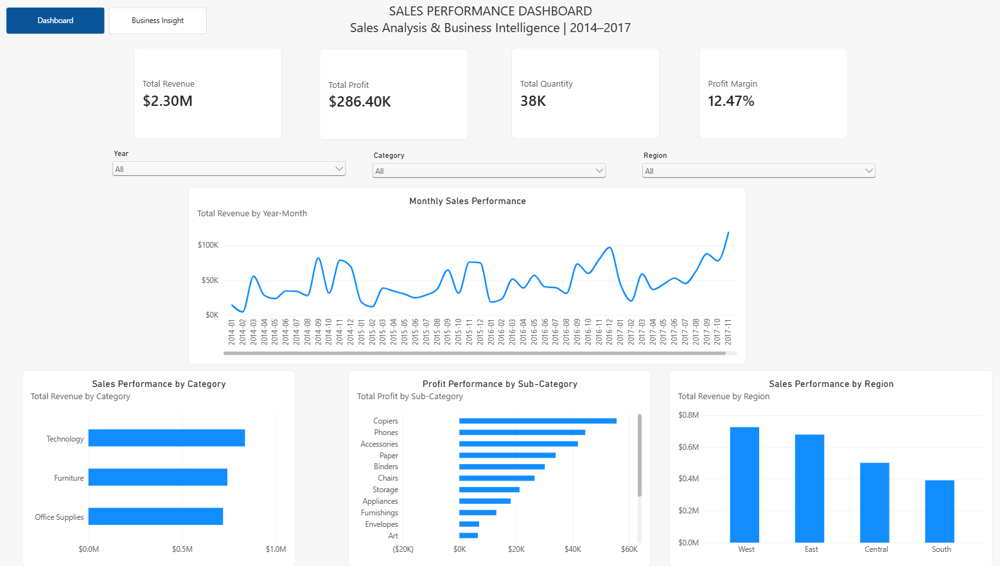
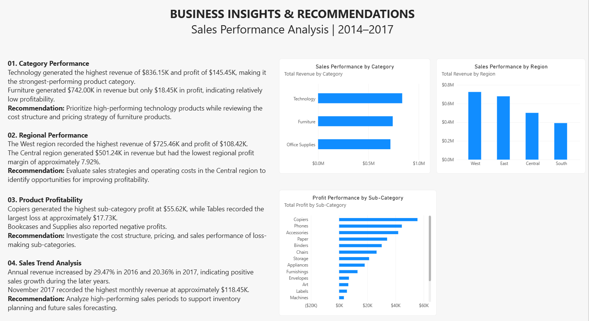

# Sales Performance Analysis Dashboard

An interactive Business Intelligence dashboard developed using Microsoft Power BI to analyze sales performance, profitability, and business trends from 2014 to 2017.

## Project Overview

This project analyzes the Sample Superstore sales dataset to evaluate business performance across product categories, sub-categories, and geographical regions.

The dashboard provides interactive visualizations and key performance indicators (KPIs) to identify sales trends, profitability issues, and opportunities for business improvement.

## Dashboard Preview

### 1. Dashboard Overview



**Key Features:**
- Total Revenue, Total Profit, Total Quantity, and Profit Margin KPIs.
- Monthly Sales Performance analysis.
- Sales Performance by Category.
- Sales Performance by Region.
- Profitability Analysis by Sub-Category.
- Interactive slicers for Year, Category, and Region.

### 2. Business Insights & Recommendations



A dedicated analysis page presenting key findings and actionable recommendations based on sales performance, regional contributions, product profitability, and monthly sales trends.

## Key Performance Indicators

| KPI | Result |
|---|---:|
| Total Revenue | $2.30M |
| Total Profit | $286.40K |
| Total Quantity | 38K |
| Profit Margin | 12.47% |

## Key Business Insights

**1. Category Performance**
- Technology generated the highest revenue ($836.15K) and profit ($145.45K).
- Furniture generated $742.00K in revenue but only $18.45K in profit.

**2. Regional Performance**
- The West region recorded the highest revenue ($725.46K) and profit ($108.42K).
- The Central region had the lowest regional profit margin (approximately 7.92%).

**3. Product Profitability**
- Copiers generated the highest sub-category profit ($55.62K).
- Tables recorded the largest loss (approximately $17.73K).

**4. Sales Trend Analysis**
- Annual revenue increased by 29.47% in 2016 and 20.36% in 2017.
- November 2017 recorded the highest monthly revenue (approximately $118.45K).

## Data Preparation & Modeling

Data preparation and transformation were performed using Power Query, including:
- Data type validation.
- Data quality and missing value checks.
- Duplicate row inspection.
- Date Table creation.
- Relationship modeling between DateTable and Orders.

## DAX Measures

The following measures were developed:
- Total Revenue
- Total Profit
- Total Quantity
- Profit Margin
- Total Sales Records
- Average Sales per Record

## Tools & Technologies

- Microsoft Power BI Desktop
- Power Query
- DAX (Data Analysis Expressions)
- CSV

## Repository Structure

```text
sales-performance-analysis-dashboard/
│
├── README.md
├── Sales_Performance_Dashboard.pbix
│
├── screenshots/
│   ├── README.md
│   ├── dashboard-overview.png
│   └── business-insights.png
│
└── dataset/
    └── README.md
```

## How to View the Dashboard

1. Download `Sales_Performance_Dashboard.pbix` from this repository.
2. Open the file using Microsoft Power BI Desktop.
3. Explore the Dashboard and Business Insights pages.
4. Use the interactive slicers to filter data by Year, Category, and Region.

## Dataset Source

**Dataset:** Superstore Sales Dataset (`superstore_sales.csv`)

- Provider: Mathew K Analytics
- Records: 9,994 rows
- Columns: 9
- Period: 2014–2017

**Source:** [Mathew K Analytics – Superstore Sales Dataset](https://www.mathewkanalytics.com/datasets/superstore-sales/)

**Download:** [Download CSV Dataset](https://www.mathewkanalytics.com/data/superstore_sales.csv)

See [dataset documentation](dataset/README.md) for more information.

## Project Information

- **Project Type:** Individual Project
- **Role:** Data Analyst & Business Intelligence Developer
- **Domain:** Business Intelligence & Data Analytics
- **Period Covered:** 2014–2017
